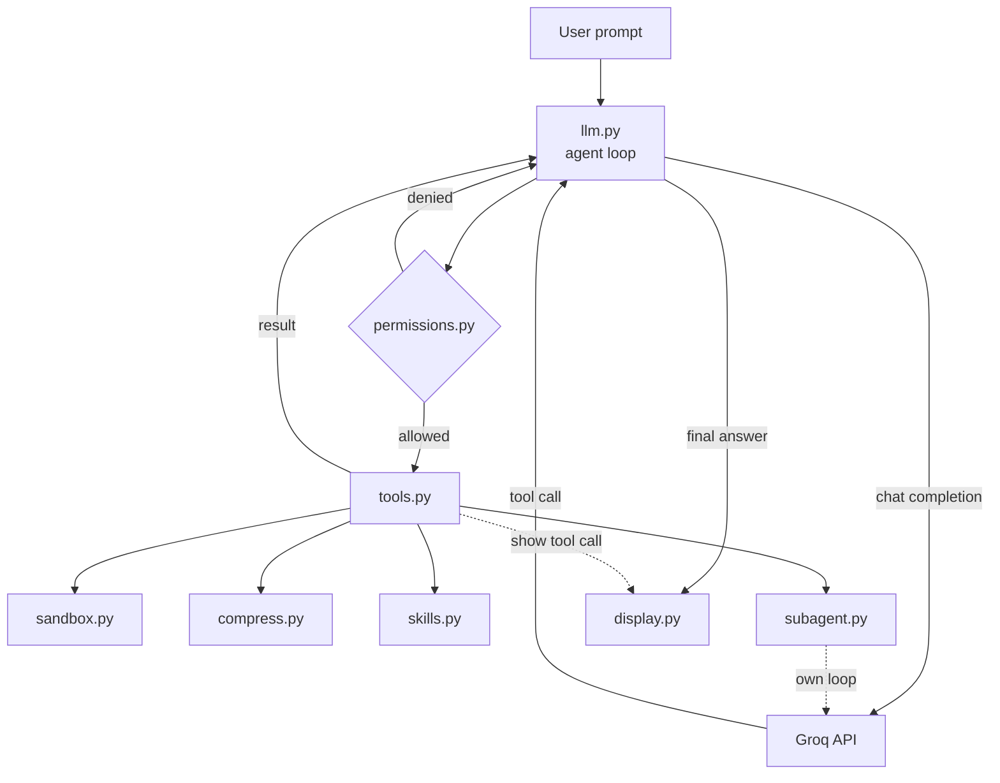

# DevAssist

DevAssist is a coding-agent harness. It connects an LLM to a set of tools and runs the whole loop in your terminal, so every tool call is visible as it happens instead of being a black box.

Anything that could change your workspace has to pass a permission check first, so the agent proposes and you approve. The rest of the harness is split into clean pieces: prompting, tool schemas, sandboxed execution, subagents, and context management. 

## What it can do

- **Use an LLM with tool calling** through the Groq API.
- **Read and write project files** using structured tools rather than relying
  on free-form model output.
- **Run shell commands** with timeout handling and Linux
  `bubblewrap` isolation.
- **Ask for approval before sensitive actions**, such as running a command or
  writing outside the project directory.
- **Delegate repository exploration to subagents** with a separate context and
  a restricted toolset.
- **Track multi-step work** with an in-memory todo list and explicit task
  statuses.
- **Load skills dynamically** from `agents/skills/*/SKILL.md`.
- **Keep context under control** by trimming large tool results and spilling
  full output to temporary files when needed.
- **Show useful terminal feedback** with prompts, loading indicators, tool
  activity panels, subagent context, and token usage.
- **Persist prompt history** at `~/.agents/history` for a smoother interactive
  workflow.


## Architecture



## Getting started

### 1. Clone the repository

```bash
git clone https://github.com/raghava7129/DevAssist.git
cd DevAssist
```

### 2. Create an environment and install dependencies

```bash
python -m venv devassist_env
source devassist_env/bin/activate
pip install -r requirements.txt
```

### 3. Configure the model provider

Create a `.env` file in the project directory:

```env
GROQ_API_KEY=your_groq_api_key
```

The default model is `openai/gpt-oss-120b`.
To use another Groq-supported
model, set it in `.env`:

```env
model=your-model-name
```

### 4. Run the current harness entry point

```bash
cd ..
python -m DevAssist.llm
```

You will be prompted for a request. The current entry point performs a model
call and executes the first tool call returned by the model, which makes it a
simple starting point for extending the harness into a longer interactive
agent loop.

## Configuration

`ROOT_PATH` controls the project root used when resolving relative file paths:

```env
ROOT_PATH=/absolute/path/to/your/project
```

If it is not set, the current working directory is used.

Review the permission policy before using DevAssist on a project containing sensitive
files.

## Skills

DevAssist looks for them in:

```text
./agents/skills/*/SKILL.md
~/agents/skills/*/SKILL.md
```

A skill needs at least a `name` and `description` in its front matter:

```markdown
---
name: testing
description: Run and interpret the project's test suite.
---

Detailed instructions for the agent go here.
```

The skill description is added to the system prompt, and the full file can be
loaded through the `read_skill` tool when needed.